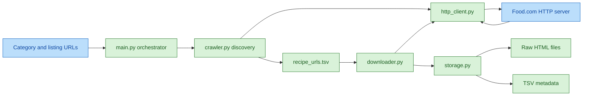
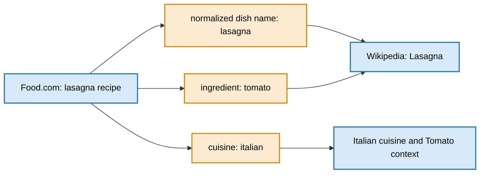

# Food.com Recipe Crawler

Crawler vytvorený pre projekt z predmetu VINF. Jeho úlohou je objaviť URL receptov na Food.com a následne stiahnuť jednotlivé stránky receptov ako raw HTML dokumenty pre ďalšie spracovanie.

---

## 1. Popis projektu

Cieľom projektu je vytvoriť vyhľadávací systém pre recepty z Food.com obohatené o súvisiace informácie z Wikipédie. Systém bude najskôr získavať recepty a ich HTML dokumenty, následne z nich extrahuje údaje, spojí ich s relevantnými Wikipedia entitami a vytvorí indexy na vyhľadávanie.

Food.com je hlavný zdroj konkrétnych receptov. Wikipedia je samostatný externý zdroj širšieho kontextu, napríklad informácií o ingredienciách, kuchyniach, pôvode jedál a kategóriách potravín. Prepojenie sa vykoná až po samostatnom spracovaní oboch zdrojov.

## 2. Použité technológie

### Frameworky a knižnice

Projekt bude implementovaný v programovacom jazyku **Python 3** s využitím nasledujúcich frameworkov a knižníc:

- **requests** – HTTP knižnica použitá v aktuálnej sekvenčnej implementácii. Vlastné malé moduly zabezpečujú plánovanie, deduplikáciu, HTTP požiadavky a ukladanie.
- **Apache Spark (PySpark)** – framework na distribuované spracovanie získaných receptov a údajov z Wikipédie. Bude slúžiť na čistenie, transformáciu, obohacovanie a join dát.
- **Vlastný Python index** – implementácia invertovaného indexu s výpočtom TF a minimálne dvoma metódami výpočtu IDF. Tento index bude použitý v prvej časti projektu na porovnanie metód vyhľadávania.
- **Apache Lucene (PyLucene)** – knižnica na fulltextové indexovanie a vyhľadávanie v spracovaných dokumentoch. Bude použitá v neskoršej fáze projektu a porovnaná s vlastným indexom.

Vlastný Python index a PyLucene majú odlišné účely. Vlastný index bude jednoduchá implementácia vytvorená pre prvú časť projektu a porovnanie metód TF/IDF. PyLucene bude neskorší, efektívnejší index pre finálne vyhľadávanie.

**Aktuálny stav implementácie:**

Prototyp crawlera je momentálne implementovaný pomocou knižnice `requests` a podporuje automatické stránkovanie, extrakciu URL receptov, deduplikáciu, sťahovanie HTML dokumentov a evidenciu metadát.

Ďalšia fáza doplní spracovanie dát pomocou PySpark a indexovanie pomocou Apache Lucene. Crawler zostáva zámerne založený na `requests`, pretože rozsah projektu nevyžaduje ďalší crawling framework.

## Odpovede na otázky

### 1. Čo je architektúra, prečo je takáto a prečo je najlepšia?

**Čo:** Pipeline má štyri vrstvy:

1. `main.py` orchestruje dve fázy v poradí discovery -> download.
2. `crawler.py` prechádza listing stránky, extrahuje URL a deduplikuje ich.
3. `http_client.py` je jediné miesto pre HTTP požiadavky, hlavičku a timeout.
4. `storage.py` a download fáza ukladajú TSV metadata a raw HTML.

**Prečo:** Každá vrstva má jednu zodpovednosť. Zmena timeoutu alebo hlavičky sa vykoná na jednom mieste; zmena formátu súborov neovplyvní logiku stránkovania.

**Prečo je to najlepšie:** Pre tento projekt je sekvenčný crawler jednoduchší, čitateľnejší a ľahšie obhájiteľný. Počet kategórií a stránkovanie sú známe, preto stačí lokálne počítadlo stránky a dve množiny pre deduplikáciu. Architektúra je stále rozšíriteľná, pretože HTTP a storage sú oddelené od fáz.

### 2. Prečo je timeout presne 10 sekúnd a pauza presne 1 sekunda?

**Čo:** `REQUEST_TIMEOUT = 10` znamená, že jedno HTTP volanie môže čakať najviac 10 sekúnd na spojenie alebo odpoveď. `REQUEST_DELAY = 1` znamená, že po každom spracovanom pokuse crawler počká jednu sekundu pred ďalšou požiadavkou.

**Prečo:** Desať sekúnd je horná hranica, ktorá umožní pomalému serveru odpovedať, ale zabráni nekonečnému zablokovaniu pipeline. Jedna sekunda znižuje frekvenciu požiadaviek na rovnaký server a je jednoduchým politeness mechanizmom. Požiadavky sú sekvenčné, takže crawler neposiela paralelné bursty.


### 3. Čo presne zapisujeme do súborov, prečo a prečo je to najlepšie?

**Čo:** Discovery dopĺňa (append) `metadata/recipe_urls.tsv` a zapisuje stĺpce `url` a `category`. Downloader pridáva do `metadata/downloads.tsv` stĺpce `recipe_id`, `url`, `filename`, `status_code` a `size_bytes`. Iba odpoveď `200` sa uloží ako presné response bytes do `data/html/<recipe_id>.html`; chyby HTML súbor nevytvárajú. Sieťová chyba má status `-1`.

**Prečo:** URL sú samostatný vstup pre download fázu. Metadata umožňujú zistiť, čo sa stalo pri každom pokuse. Raw HTML sa ukladá oddelene, aby sa dalo opakovane parsovať bez ďalšieho zaťaženia Food.com a bez straty pôvodných bytes.

**Prečo je to najlepšie:** TSV je jednoduchý, čitateľný a priamo načítateľný Python alebo Spark nástrojmi. Priebežný `flush` znižuje stratu dát pri prerušení. Resume podmienka vyžaduje úspešný záznam aj existujúci HTML súbor, takže chýbajúci súbor sa omylom nepovažuje za dokončený.

### 4. Ako sa riešia chyby, deduplikácia a pokračovanie?

**Čo:** Discovery zastaví aktuálnu kategóriu pri chybe listing požiadavky, skončí kategóriu pri opakovaní poslednej stránky a používa `seen_category_links` aj `seen_recipe_links`. Downloader pokračuje po HTTP chybe, zapíše status a pri sieťovej chybe zapíše `-1`. Úspešne stiahnuté URL sa pri ďalšom spustení preskočia.

**Prečo:** Opakovaná posledná stránka Food.com je doménové pravidlo, ktoré je spoľahlivejšie než hádanie maximálneho počtu stránok. Dve množiny riešia dva rôzne problémy: koniec stránkovania v jednej kategórii a duplicitu v celom datasete. Priebežné zápisy chránia už získané dáta.

**Prečo je to najlepšie:** Nie sme závislí od Scrapy. Malý vlastný scheduler je primeraný známemu URL priestoru, ľahko sa vysvetľuje a zachováva presný formát výstupov. Neskôr možno doplniť retry s exponential backoffom alebo databázu bez zmeny parsera a storage rozhrania.


### HTTP hlavičky, timeout a pauza medzi požiadavkami

Pri každej HTTP požiadavke sa používa hlavička `User-Agent`:

```python
{
      "User-Agent": "VINF-STU-Student-Crawler/1.0"
}
```

Hlavička `User-Agent` identifikuje klienta, ktorý požiadavku odosiela. Server tak vie, že požiadavka pochádza z nášho študentského crawlera, a nie z bežného webového prehliadača.

Použité hodnoty:

- **timeout:** 10 sekúnd,
- **pauza medzi požiadavkami:** 1 sekunda,
- **paralelné požiadavky:** nepoužívajú sa; požiadavky sa odosielajú postupne.

Timeout určuje, ako dlho crawler čaká na nadviazanie spojenia alebo na odpoveď servera. Pauza je zámerné čakanie po spracovaní požiadavky, ktoré znižuje zaťaženie servera a zabraňuje príliš rýchlemu odosielaniu požiadaviek.

Ak dôjde k výpadku siete, požiadavka môže zlyhať okamžite alebo po uplynutí timeoutu. Pri statusoch 429, 5xx a sieťovej chybe crawler požiadavku zopakuje najviac 2× s pauzou 10 sekúnd. Stránky s 404 sa pri ďalšom spustení preskočia. Pri discovery fáze sa aktuálna kategória preskočí, pri download fáze sa sieťová chyba zapíše do metadata so statusom `-1` a pokračuje sa ďalšou URL.

### Súčasný stav crawlera a ukážka dát

Implementácia sa nachádza v súboroch `crawler/crawler.py`, `crawler/downloader.py` a `crawler/main.py`.

Crawler pracuje v dvoch fázach:

1. **Discovery:** prechádza listing stránky Food.com, extrahuje URL receptov a ukladá ich do `metadata/recipe_urls.tsv`.
2. **Download:** načíta objavené URL, stiahne raw HTML a uloží ho do `data/html/` podľa ID receptu. Výsledky požiadaviek zapisuje do `metadata/downloads.tsv`.

Aktuálne je v `data/html/` uložených 24 HTML dokumentov. Príklady stiahnutých stránok:

- `data/html/15541.html` – `4-hour-beef-stew`,
- `data/html/112835.html` – `1956-stuffed-onions`,
- `data/html/70099.html` – `1-asian-noodle-salad`,
- `data/html/333060.html` – `1-best-vegan-style-granola-in-the-world`.

Úspešné odpovede s HTTP statusom `200` sa ukladajú ako raw HTML. Stránky s chybovým statusom, napríklad `404`, sa neukladajú, ale ich výsledok sa zaznamená v súbore `metadata/downloads.tsv`.

### Pomocné knižnice

Projekt je implementovaný v **Python 3**.

Použité knižnice:

- `requests` – HTTP požiadavky
- `re` – extrakcia URL receptov z HTML
- `csv` – čítanie a zápis TSV súborov
- `pathlib` – práca so súbormi a adresármi
- `time` – interval medzi HTTP požiadavkami
- `json` – extrahované recepty a index
- `unittest` – testy extraktora
- `tiktoken` – počet tokenov v štatistike

---

### Zdroje dát

Primárnym zdrojom dát je **Food.com**.

Crawler využíva sekciu *All Recipes by Title*, v ktorej sú recepty rozdelené do kategórií:

```text
123, A, B, C, ... Z
```

Listing stránky majú tvar:

```text
https://www.food.com/browse/allrecipes/?page={page}&letter={category}
```

Napríklad:

```text
https://www.food.com/browse/allrecipes/?page=1&letter=A
```

Samotný recept má URL napríklad:

```text
https://www.food.com/recipe/4-hour-beef-stew-15541
```

Pred implementáciou crawlera bol skontrolovaný súbor `robots.txt`. Cesty používané crawlerom (`/browse/allrecipes/` a `/recipe/`) nie sú pre všeobecného crawlera uvedené medzi zakázanými cestami.

Crawler nepoužíva paralelné sťahovanie a medzi požiadavkami čaká 1 sekundu.

---

## 3. Návrh architektúry systému

Architektúra je navrhnutá ako postupný dátový pipeline. Najskôr sa z Food.com získajú URL a raw HTML dokumenty. Až potom sa HTML spracujú, spoja s údajmi z Wikipédie a zaindexujú. Wikipedia teda nie je súčasťou samotného crawlovania Food.com; je to druhý, samostatný zdroj dát, ktorý sa pripojí v neskoršej fáze.

### A. High-Level Design – Plánovaná architektúra systému

Používateľské rozhranie zatiaľ nie je špecifikované. Z pohľadu dátového systému sú vstupmi a výstupmi:

| Časť | Vstup | Výstup |
|---|---|---|
| Food.com crawler | kategórie a listing URL Food.com | zoznam URL receptov, raw HTML, metadata sťahovania |
| Wikipedia spracovanie | Wikipedia dump a extrahované receptové dáta | normalizované Wikipedia entity a prepojené záznamy |
| Indexovanie | spracované recepty a Wikipedia atribúty | vlastný TF/IDF index a neskôr PyLucene index |
| Interface | vyhľadávací dopyt | výsledky vyhľadávania |

Plánovaná architektúra oddeľuje získavanie dát, spracovanie a indexovanie. Food.com a Wikipedia sú dva nezávislé zdroje. Food.com crawler získava recepty, zatiaľ čo Wikipedia dump sa spracuje samostatne. PySpark následne vyčistí, normalizuje a spojí údaje z oboch zdrojov.

```mermaid
flowchart LR
      FOOD["Food.com"]:::external
      WIKI["Wikipedia Dump"]:::external

      subgraph OFFLINE["OFFLINE: DATA PREPARATION"]
            MAIN["main.py<br/>Pipeline Orchestrator"]:::implemented
            CONFIG["config.py<br/>Shared Paths · Headers · Timeout · Delay"]:::implemented
            DISCOVERY["crawler.py<br/>Listing Discovery · Pagination · Deduplication"]:::implemented
            DOWNLOAD["downloader.py<br/>Recipe Downloads · Resume"]:::implemented
            HTTP["http_client.py<br/>Shared requests.get() Boundary"]:::implemented
            STORAGE_HELPERS["storage.py<br/>HTML Saving · Completed URL Loading"]:::implemented
      end

      subgraph STORAGE["1. RAW DATA STORAGE"]
            URLS[("Recipe URLs<br/>recipe_urls.tsv")]:::implemented
            HTML[("Raw HTML<br/>data/html/")]:::implemented
            META[("Download Metadata<br/>downloads.tsv")]:::implemented
      end

      subgraph EXTRACTION["2. DATA EXTRACTION"]
            RECIPE["Recipe Parser<br/>Title · Ingredients · Cuisine · Time"]:::planned
            WIKIPARSER["Wikipedia Parser<br/>Entities · Aliases · Categories"]:::planned
      end

      subgraph PROCESSING["3. DISTRIBUTED PROCESSING & ENRICHMENT - PySpark"]
            SPARK["Data Cleaning & Normalization<br/>Recipes + Wikipedia Entities"]:::planned
            MATCH["Entity Matching<br/>Names · Aliases · Ingredients · Cuisine"]:::planned
            JOIN["Dataset Join<br/>Recipe + Wikipedia Attributes"]:::planned
            DATASET[("Enriched Recipe Dataset")]:::planned
      end

      subgraph INDEXING["4. SEARCH INDEXING"]
            CUSTOM["Custom Inverted Index<br/>TF + Two IDF Methods"]:::planned
            LUCENE["PyLucene<br/>Full-Text Search Index"]:::planned
      end

      subgraph SEARCH["ONLINE: 5. INFORMATION RETRIEVAL"]
            QUERY["User Query"]:::planned
            ENGINE["Query Processing & Ranking<br/>Selected Index"]:::planned
            RESULTS["Ranked Recipe Results"]:::planned
      end

      FOOD --> MAIN
      MAIN --> DISCOVERY
      MAIN --> DOWNLOAD
      CONFIG --> DISCOVERY
      CONFIG --> DOWNLOAD
      CONFIG --> HTTP
      DISCOVERY --> HTTP
      DOWNLOAD --> HTTP
      HTTP --> FOOD
      DISCOVERY --> URLS
      URLS --> DOWNLOAD
      DOWNLOAD --> STORAGE_HELPERS
      STORAGE_HELPERS --> HTML
      DOWNLOAD --> META
      HTML --> RECIPE
      WIKI --> WIKIPARSER
      RECIPE --> SPARK
      WIKIPARSER --> SPARK
      SPARK --> MATCH
      MATCH --> JOIN
      JOIN --> DATASET
      DATASET --> CUSTOM
      DATASET --> LUCENE
      QUERY --> ENGINE
      CUSTOM --> ENGINE
      LUCENE --> ENGINE
      ENGINE --> RESULTS

      classDef implemented fill:#d5f5e3,stroke:#239b56,color:#000,stroke-width:2px;
      classDef planned fill:#fdebd0,stroke:#d68910,color:#000,stroke-width:2px;
      classDef external fill:#d6eaf8,stroke:#2874a6,color:#000,stroke-width:2px;
```



Legenda: zelená označuje aktuálne implementované časti, oranžová plánované časti a modrá externé zdroje dát.

## 4. Architektúra crawl systému

### 4.1 Požiadavky na crawl systém

Funkčné požiadavky:

1. Prejsť listing stránky Food.com podľa kategórie a stránkovania.
2. Extrahovať URL receptov a odstrániť duplicity.
3. Stiahnuť dostupné stránky receptov ako raw HTML.
4. Uložiť metadata o každom pokuse o stiahnutie.
5. Vedieť pokračovať bez opätovného sťahovania úspešne uložených stránok.
6. Extrahovať z receptov údaje potrebné na vyhľadávanie, napríklad názov, ingrediencie, čas prípravy a kuchyňu.
7. Spracovať Food.com dáta a Wikipedia dump pomocou PySpark.
8. Prepojiť recepty s relevantnými Wikipedia entitami.
9. Vytvoriť vlastný TF/IDF index a neskôr PyLucene index.

Nefunkčné požiadavky:

- **Spoľahlivosť:** výpadok jednej požiadavky nesmie poškodiť už uložené dáta.
- **Obnovenie:** crawler musí ukladať výsledky priebežne a umožniť pokračovanie.
- **Slušnosť:** používať identifikačný `User-Agent`, timeout a pauzu medzi požiadavkami; rešpektovať `robots.txt`.
- **Reprodukovateľnosť:** ukladať URL, status, názov súboru a veľkosť odpovede.
- **Škálovateľnosť:** aktuálny crawler je sekvenčný prototyp; neskoršie veľké spracovanie zabezpečí PySpark.
- **Deduplikácia:** rovnakú URL nespracovať opakovane a pri ďalšom spracovaní kontrolovať existujúce výsledky.


### 4.2 Architektúra crawlera

#### Aktuálna implementácia crawlera – requests

`crawler/main.py` je orchestrátor pipeline. Spúšťa discovery a následne download. Ak discovery zlyhá, pipeline sa zastaví; download sa nespúšťa s neúplným zoznamom URL.

`crawler/crawler.py` je discovery modul. Vytvára listing URL v tvare `page + letter`, posiela HTTP požiadavky, extrahuje relatívne URL receptov regulárnym výrazom, odstraňuje duplicity a zapisuje globálne unikátne URL do `metadata/recipe_urls.tsv`. Množina `seen_category_links` deteguje opakovanie poslednej listing stránky a množina `seen_recipe_links` zabraňuje duplicite naprieč kategóriami.

`crawler/downloader.py` je download modul. Načíta objavené URL, odvodí ID receptu z konca URL, uloží úspešnú odpoveď do `data/html/<recipe_id>.html` a každý pokus zapíše do `metadata/downloads.tsv`. Pred stiahnutím kontroluje úspešné záznamy a existujúci HTML súbor, takže už dokončenú URL preskočí.

`metadata/recipe_urls.tsv` je výstup discovery fázy a vstup download fázy. Obsahuje URL a kategóriu, v ktorej bola URL nájdená.

`metadata/downloads.tsv` je stavová evidencia download fázy. Obsahuje ID receptu, URL, názov uloženého súboru, HTTP status a veľkosť odpovede. Status `200` znamená uložený dokument; `404` alebo `-1` znamená neúspešný pokus bez uloženia HTML.

`data/html/` je úložisko raw HTML. Raw dokumenty sa ukladajú ako bytes, aby sa zachoval obsah prijatý zo servera a aby sa extrakcia dala neskôr zopakovať bez ďalšieho zaťaženia Food.com.

#### Architektúra requests crawlera

Aktuálna architektúra má jednoduchý explicitný tok:



Výstupy `data/html/` a `metadata/downloads.tsv` vytvára aktuálna storage vrstva. Kontrola úspešne dokončených URL je tiež explicitná, takže resume správanie nie je skryté v externom frameworku.

#### Ukladanie dát a výstupy

Aktuálna implementácia ukladá objavené URL do `metadata/recipe_urls.tsv`, raw HTML dokumenty do `data/html/` a výsledok každého download pokusu do `metadata/downloads.tsv`. Formát TSV a resume správanie zabezpečuje vlastná storage vrstva.

### 4.3 Tok dát a spracovanie požiadaviek

Podrobný plánovaný tok dát je uvedený v podsekcii **Plánovaný dátový tok** vyššie. V aktuálnej implementácii sa používa rovnaká logická postupnosť: discovery vytvorí `recipe_urls.tsv`, download vytvorí raw HTML a `downloads.tsv`, a až následné plánované etapy vykonajú extrakciu, PySpark join a indexovanie.

### 4.4 Ukladanie dát

Aktuálna implementácia ukladá objavené URL do `metadata/recipe_urls.tsv`, raw HTML dokumenty do `data/html/` a výsledok každého download pokusu do `metadata/downloads.tsv`. Tieto súbory sú stabilné rozhranie medzi etapami pipeline.

#### Plánované komponenty a funkcionalita

Nasledujúce časti patria do ďalších etáp projektu a nie sú súčasťou aktuálneho crawlera:

- extrakcia všetkých receptových polí z HTML,
- Wikipedia dump a jeho čistenie,
- normalizácia názvov ingrediencií a entít,
- join Food.com dát s Wikipédiou,
- vlastný invertovaný index s TF a dvoma IDF metódami,
- PySpark distribuované spracovanie,
- PyLucene index,
- používateľské interface.

### Prepojenie Food.com a Wikipédie

Food.com poskytuje konkrétne recepty. Wikipedia poskytuje širší kontext, ktorý recept nemusí obsahovať, napríklad kategórie potravín, typ kuchyne, pôvod jedla, synonymá ingrediencií alebo vzťahy medzi všeobecným pojmom a konkrétnou ingredienciou.

Tieto zdroje sa nebudú spájať podľa náhodnej zhody celého HTML dokumentu. Najskôr sa z oboch zdrojov vytvoria normalizované entity:

```text
Food.com recept
      title: lasagna
      ingredients: tomato, cheese, pasta
      cuisine: italian

Wikipedia entity
      title: Lasagna
      aliases: lasagne
      cuisine: Italian cuisine
      categories: pasta dish, Italian food
```

Join bude založený na kombinácii normalizovaného názvu, aliasov, ingrediencií a kuchyne. Proces bude pozostávať z týchto krokov:

1. Z Food.com sa extrahuje názov receptu, zoznam ingrediencií a dostupná informácia o kuchyni.
2. Z Wikipédie sa extrahujú názvy stránok, redirecty, kategórie, relevantný text a odkazy medzi entitami.
3. Texty sa normalizujú, napríklad prevedením na malé písmená, odstránením nadbytočnej interpunkcie a zjednotením vybraných variantov názvov.
4. Vytvoria sa spojovacie kľúče, napríklad `normalized_ingredient` alebo `normalized_dish_name`.
5. PySpark vykoná join medzi receptovým datasetom a Wikipedia datasetom.
6. Výsledok bude obsahovať pôvodný recept aj pripojené Wikipedia atribúty a identifikátor Wikipedia stránky.

Príklad:



Join sa vykoná až po extrakcii a čistení dát. Crawler teda iba získava dokumenty; nerozhoduje o tom, ktorá Wikipedia stránka je relevantná.

### 4.5 Technické rozhodnutia

#### Vysvetlenie podľa návrhu web crawlera

Návrh z použitého článku je prispôsobený tomuto projektu nasledovne:

1. **Requirements:** definujeme, čo crawler prijíma, čo ukladá a aké chyby musí zvládnuť.
2. **System interface:** vstupom sú Food.com listing URL a neskôr Wikipedia dump; výstupom sú dokumenty, metadata a spracované datasety.
3. **Data flow:** URL sa vyberie, stiahne, overí, uloží, extrahuje a až potom sa pridá do ďalšej fázy.
4. **Frontier:** v aktuálnej verzii ju predstavuje stránkové počítadlo a množiny `seen_category_links` a `seen_recipe_links`. Samostatná Kafka/Redis fronta nie je potrebná pre jeden web a sekvenčný crawl.
5. **Fetcher:** implementujú ho volania `requests.get()` s hlavičkou, timeoutom a kontrolou statusu.
6. **Parser:** aktuálne regex extrahuje URL; neskôr sa doplní extrakcia receptových polí a entít.
7. **Storage:** raw HTML je oddelené od TSV metadát, aby sa veľký obsah neposielal cez riadiacu frontu a aby sa dal opakovane spracovať.
8. **Fault tolerance:** priebežný `flush`, persistentné metadata a preskakovanie úspešne dokončených URL chránia už získané výsledky.
9. **Politeness:** `User-Agent`, timeout a jednosekundová pauza obmedzujú zaťaženie Food.com. `robots.txt` bol overený pred crawlom.
10. **Scaling:** súčasná verzia škáluje zvisle a sekvenčne. Pri veľkom objeme sa dá discovery/download rozdeliť na pracovné dávky, ale hlavné distribuované spracovanie je plánované pre PySpark.

#### Hlbšie technické rozhodnutia

**Frontier a deduplikácia.** Pri všeobecnom web crawlery by frontier obsahovala veľké množstvo URL a vyžadovala by distribuovanú frontu. Tento projekt má známy doménový rozsah a stránkovanie podľa písmen, preto je jednoduché stránkové počítadlo vhodné. Dve množiny riešia rozdielne problémy: jedna ukončuje kategóriu pri opakovanej stránke a druhá chráni celý dataset pred duplicitami.


**Slušnosť a robots.txt.** Crawler nepoužíva paralelné požiadavky a čaká jednu sekundu. `User-Agent` identifikuje klienta. Pravidlá `robots.txt` boli overené pred crawlom; cesty crawlera nie sú zakázané. Pri jednom hostiteľovi nie je potrebná distribuovaná per-domain rate-limit služba.

**Deduplikácia obsahu.** URL deduplikácia je implementovaná. Neskôr je možné pridať SHA-256 hash uloženého HTML, aby sa odhalili rôzne URL s rovnakým obsahom. Pre aktuálny rozsah to nie je podmienka.

**Crawler traps.** Keďže crawler neprechádza ľubovoľné odkazy po celom webe, ale používa pevný listing Food.com a končí pri opakovanej stránke, riziko nekonečného prechádzania je malé. Aj tak sa pri plnom behu môže nastaviť maximálny počet stránok alebo kontrola opakovania.

**Škálovanie a úložisko.** Článok uvažuje o miliardách stránok a cloudovej fronte. Tento projekt má menší rozsah, preto by Kafka, Redis, S3 alebo databáza pre frontier boli zbytočne zložité. Raw HTML a TSV sú vhodné pre prvú fázu; PySpark neskôr načíta spracované súbory a vytvorí dataset vhodný na ďalšie spracovanie.

**Pozorovanie behu.** Konzolové logy a `downloads.tsv` umožňujú sledovať počet pokusov, statusy, uložené súbory a veľkosť odpovedí. Pri rozšírení je vhodné doplniť súhrn úspešných, neúspešných a preskočených URL, celkový čas behu a počet duplicitných URL.
## 5. Implementácia crawlera

### Štruktúra projektu

- `crawler/main.py`
- `crawler/crawler.py`
- `crawler/downloader.py`
- `data/html/<recipe_id>.html`
- `metadata/README.md`
- `metadata/recipe_urls.tsv`
- `metadata/downloads.tsv`

### 5.1 Discovery fáza

Discovery fáza je implementovaná vo funkcii `discover_recipes()` v súbore `crawler/crawler.py`.

Crawler postupne prechádza listing stránky jednotlivých kategórií.

Pre plný crawl sú kategórie:

```python
["123"] + list(string.ascii_uppercase)
```

Počas testovania sa používa iba:

```python
["123", "Z"]
```

---

## Extrakcia URL

Z HTML listing stránky sa odkazy na recepty získavajú regulárnym výrazom:

```python
r'href=["\'](/recipe/[^"\']+-\d+)["\']'
```

Napríklad:

```html
<a href="/recipe/4-hour-beef-stew-15541">
```

sa transformuje na:

```text
https://www.food.com/recipe/4-hour-beef-stew-15541
```

---

## Deduplikácia

Crawler používa dve množiny.

`seen_category_links` uchováva URL, ktoré už boli nájdené v aktuálnej kategórii. Používa sa na detekciu konca stránkovania.

`seen_recipe_links` uchováva URL nájdené naprieč všetkými kategóriami a zabraňuje duplicitám vo výslednom datasete.

---

## Detekcia konca stránkovania

Pri testovaní bolo zistené, že Food.com po prekročení poslednej stránky kategórie nevracia prázdnu stránku ani HTTP 404.

Namiesto toho opakuje poslednú existujúcu listing stránku.

Napríklad pre kategóriu `123`:

```text
page 23 → 100 nových receptov
page 24 → 95 nových receptov
page 25 → 0 nových receptov
```

Crawler preto skončí spracovanie kategórie vtedy, keď ďalšia listing stránka neobsahuje žiadnu URL, ktorá ešte nebola v danej kategórii spracovaná.

Počet stránok kategórie tak nemusí byť nastavený manuálne.

---

## Výstup discovery fázy

Objavené recepty sa ukladajú do:

```text
metadata/recipe_urls.tsv
```

Formát:

```text
url	category
```

Napríklad:

```text
https://www.food.com/recipe/4-hour-beef-stew-15541	123
```

---

### 5.2 Download fáza

Download fáza je implementovaná vo funkcii:

```python
download_recipes()
```

v:

```text
crawler/downloader.py
```

Downloader načíta URL zo súboru:

```text
metadata/recipe_urls.tsv
```

a postupne stiahne stránky jednotlivých receptov.

---

## Identifikácia receptov

Numerické ID sa získava z konca URL.

Napríklad:

```text
https://www.food.com/recipe/4-hour-beef-stew-15541
```

má ID:

```text
15541
```

Dokument sa preto uloží ako:

```text
data/html/15541.html
```

---

## Ukladanie raw HTML

Úspešná HTTP odpoveď (`HTTP 200`) sa ukladá priamo ako bytes pomocou:

```python
response.content
```

a súbor sa zapisuje v binárnom režime:

```python
"wb"
```

Tým sa zachová obsah HTTP odpovede bez dodatočného dekódovania a opätovného kódovania HTML crawlerom.

---

## HTTP konfigurácia

| Parameter | Hodnota |
|---|---|
| User-Agent | `VINF-STU-Student-Crawler/1.0` |
| Timeout | 10 sekúnd |
| Sleep | 1 sekunda |
| Paralelné požiadavky | Nie |

Crawler používa sekvenčné požiadavky.

Medzi požiadavkami je interval:

```text
1 sekunda
```

---

## Spracovanie chýb

Pri HTTP odpovedi `200` sa stránka uloží.

Pri HTTP chybách, napríklad:

```text
404
```

sa HTML súbor neuloží, ale výsledok požiadavky sa zaznamená do metadát.

Sieťové chyby, napríklad timeout alebo problém so spojením, sa zachytávajú pomocou:

```python
requests.RequestException
```

Ak server neposkytne HTTP odpoveď, v metadátach sa používa:

```text
status_code = -1
```

čo reprezentuje sieťové zlyhanie bez HTTP statusu.

---

## Metadata

Metadata o pokusoch o stiahnutie sa ukladajú do:

```text
metadata/downloads.tsv
```

Stĺpce:

```text
recipe_id
url
filename
status_code
size_bytes
```

Metadata sa medzi spusteniami zachovávajú a nové výsledky sa pridávajú do existujúceho TSV súboru.

Ak už existuje HTML súbor a zároveň je daná URL evidovaná ako úspešne stiahnutá (`HTTP 200`), downloader ju znova nesťahuje.

---

### 5.3 Pipeline

Celý crawler je možné spustiť cez:

```text
crawler/main.py
```

`crawler/main.py` postupne zavolá:

```text
discover_recipes()
        ↓
download_recipes()
```

Ak discovery fáza zlyhá, download fáza sa nespustí.

---

## Spustenie celého systému

Z koreňového adresára projektu:

```bash
python3 -m crawler.main
```

Jednotlivé fázy je možné spustiť aj samostatne.

Discovery:

```bash
python3 -m crawler.crawler
```

Download:

```bash
python3 -m crawler.downloader
```

---

## 6. Testovanie a výsledky

### 6.1 Testovacia konfigurácia

Pôvodná testovacia konfigurácia bola:

V `crawler/config.py`:

```python
CATEGORIES = ["123", "Z"]
```

V `crawler/config.py`:

```python
DOWNLOAD_LIMIT = 30
```

To umožňuje testovať celý pipeline bez spustenia veľkého sťahovania.

---

### 6.2 Plná konfigurácia

Pre discovery všetkých kategórií:

```python
CATEGORIES = ["123"] + list(string.ascii_uppercase)
```

Pre spracovanie všetkých objavených URL:

```python
DOWNLOAD_LIMIT = None
```

Plná konfigurácia sa použije až pri zbere finálneho datasetu.

---

### 6.3 Výsledky testovania

Discovery crawler bol testovaný na kategóriách:

```text
123
Z
```

Výsledok:

```text
5 433 unikátnych URL receptov
```

Downloader bol testovaný na prvých 30 URL.

Výsledok:

| Výsledok | Počet |
|---|---:|
| Testovaných URL | 30 |
| Úspešne stiahnutých HTML dokumentov | 24 |
| HTTP 404 | 6 |

Niektoré URL dostupné na listing stránkach Food.com teda už odkazujú na neexistujúce stránky. Downloader takéto prípady spracuje bez ukončenia celého procesu.

---

### 6.4 Veľkosť testovacích dát

24 úspešne stiahnutých HTML dokumentov má spolu približne:

```text
7.6 MB
7 800 KB
```

Priemerná veľkosť dokumentu v testovacej vzorke:

```text
7 800 KB / 24 ≈ 325 KB
```

Odhad počtu dokumentov potrebných na 500 MB:

```text
512 000 KB / 325 KB ≈ 1 575 dokumentov
```

Pre vytvorenie rezervy sa preto počíta približne s **1 600 – 2 000 úspešne stiahnutými HTML dokumentmi**.

Ide o orientačný odhad založený na aktuálnej testovacej vzorke.

---

### 6.5 Aktuálny stav implementácie

Implementované je:

- automatické prechádzanie listing stránok,
- kategórie `123` a `Z` (ďalšie písmená sa pridajú v `config.py`),
- automatická paginácia,
- detekcia opakovanej poslednej stránky,
- extrakcia URL receptov,
- deduplikácia URL,
- TSV zoznam objavených receptov,
- sťahovanie raw HTML,
- stabilné názvy súborov podľa ID receptu,
- persistentné metadata,
- kontrola už stiahnutých dokumentov,
- spracovanie HTTP chýb,
- evidencia sieťových chýb,
- timeout,
- interval medzi požiadavkami,
- samostatné spustenie jednotlivých fáz,
- spoločné spustenie celého pipeline cez `crawler/main.py`.

## 7. Plánované rozšírenia

Plánované časti systému sú rozdelené do ďalších etáp projektu:

- extrakcia receptových polí a entít z HTML,
- spracovanie a čistenie Wikipedia dumpu,
- normalizácia názvov ingrediencií, jedál a kuchýň,
- PySpark join medzi Food.com datasetom a Wikipedia datasetom,
- vlastný invertovaný index s TF a dvoma metódami IDF,
- samostatný PyLucene index a porovnanie výsledkov s vlastným indexom,
- používateľské interface, ktorého konkrétna forma bude určená po konzultácii.

## 8. Extraktor, indexer a report (1. odovzdanie)

Podrobný opis je v reporte na wiki (`report/wiki_report.txt`, generovaný skriptom `report/build_report.py`).

```bash
python3 -m crawler.downloader      # stiahnutie všetkých URL (DOWNLOAD_LIMIT = None)
python3 -m extractor.main          # regex extrakcia -> data/recipes.jsonl
python3 -m indexer.indexer         # invertovaný index (TF) -> data/index/index.json
python3 -m indexer.search "beef stew" --idf bm25
python3 -m indexer.compare         # porovnanie IDF -> metadata/idf_comparison.md
python3 -m stats.stats             # štatistika -> metadata/stats.md
python3 -m unittest discover tests -v
python3 -m report.build_report     # report pre wiki
```
